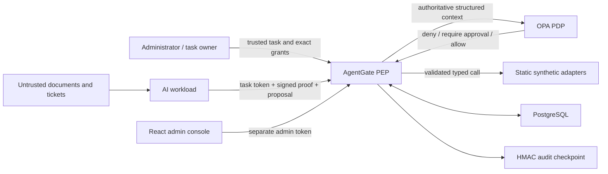
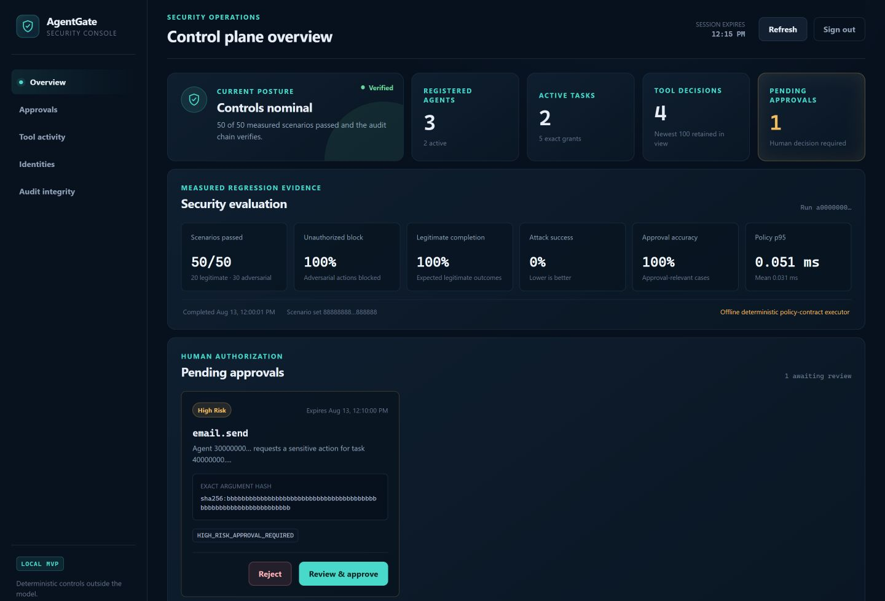

# AgentGate

[](https://github.com/aariffaadlee/AgentGate/actions/workflows/ci.yml)

AgentGate is a local, educational Zero Trust security runtime that mediates every
synthetic tool call made by an AI agent. Authorization is deterministic and
enforced outside the language model.

> **Current status:** Phase 9 implements the secure backend foundation, workload
> identity, task-scoped credentials, proof-of-possession, revocation, OPA
> authorization, a contained gateway for seven synthetic tools, and exact-request
> administrator approval with expiry and replay protection, plus authoritative
> provenance and untrusted-data propagation, plus a keyed tamper-evident audit
> chain and external checkpoint, plus a measured 50-case adversarial evaluation
> harness and an administrator-only React security console. Nothing in this
> repository should be treated as production ready. Phase 9 adds pinned CI,
> dependency/static analysis, live Compose gates, a proof-bound demonstration
> client, complete operator/security documentation, and portfolio evidence.

## Why authorization lives outside the model

A model can be influenced by its user, retrieved documents, tickets, tool output,
or poisoned context. Instructions such as “never do X” are not an enforceable
security boundary when the same model interprets both trusted goals and untrusted
content. AgentGate therefore treats the agent as an untrusted workload: it may
propose a typed action, but it cannot grant itself identity, capability, trust,
risk, approval, or access to an adapter.

## Architecture



### Trust boundaries

The key trust boundaries are external content to agent, agent to enforcement
point, enforcement point to OPA, enforcement point to adapters, administrator to
approval service, and application to PostgreSQL/checkpoint storage. The model and
browser are never policy authorities. See the detailed
[architecture](docs/architecture.md) and [security model](docs/security-model.md).

## Dashboard

The screenshot below uses a synthetic local fixture. No real identities,
credentials, messages, or external-system data are shown.



## Design

- [MVP and phased implementation plan](docs/phase-0-plan.md)
- [Security architecture](docs/architecture.md)
- [Security model and enforcement contract](docs/security-model.md)
- [STRIDE threat model](docs/threat-model.md)
- [Identity and request-proof protocol](docs/identity-protocol.md)
- [API guide](docs/api.md)
- [Evaluation methodology](docs/evaluation-methodology.md)
- [Portfolio demonstration](docs/demonstration.md)
- [Resume-ready project summary](docs/resume-summary.md)
- [Security policy](SECURITY.md)
- [Contributing guide](CONTRIBUTING.md)

Detailed phase walkthroughs:

- [Phase 0 — security design before implementation](docs/phase-0-explained.md)
- [Phase 1 — secure backend and persistence foundation](docs/phase-1-explained.md)
- [Phase 2 — workload identity and deterministic authorization](docs/phase-2-explained.md)
- [Phase 3 — contained tool gateway and enforcement path](docs/phase-3-explained.md)

- [Phase 4 — exact-request human approval](docs/phase-4-explained.md)
- [Phase 5 — authoritative provenance and trust propagation](docs/phase-5-explained.md)
- [Phase 6 — keyed audit integrity and verification](docs/phase-6-explained.md)
- [Phase 7 — measured adversarial evaluation](docs/phase-7-explained.md)
- [Phase 8 — administrator security dashboard](docs/phase-8-explained.md)

- [Phase 9 — CI, security gates, demonstration, and project completion](docs/phase-9-explained.md)

Phases 1 through 9 provide:

- FastAPI application factory and async SQLAlchemy/PostgreSQL lifecycle
- strict environment configuration with secret-safe database URL handling
- structured JSON logs with recursive credential redaction
- trusted request correlation IDs, restrictive security headers, and local CORS
- request-body limits enforced before JSON parsing
- stable API error envelopes without reflected exceptions
- liveness and dependency-aware readiness endpoints
- normalized tables for identities, tasks, credentials, capabilities, requests,
  policy decisions, approvals, provenance, audit events, and evaluations
- explicit reversible Alembic migrations
- administrator/workload audience separation
- strict Ed25519 public JWK registration and RFC 7638 key thumbprints
- five-minute, server-signed JWT credentials whose capabilities come only from
  persisted task grants
- one-time signed request proofs bound to method, path, canonical body hash, and
  the access-token hash
- agent/task assignment, live credential checks, and append-only revocation facts
- a fail-closed OPA HTTP client and default-deny Rego policy with stable reasons
- an immutable seven-tool executable registry with a checksummed database mirror
- strict, non-coercing argument and result schemas with unknown-field rejection
- synthetic document, ticket, mailbox, file-sandbox, and query-template adapters
- atomic PostgreSQL rate windows, adapter timeouts, and request/result size limits
- encrypted tool arguments, sanitized result summaries, and persisted decisions
- an authenticated `POST /tool-requests` policy-enforcement path
- expiring approvals bound to agent, task, tool, request, and canonical arguments
- administrator-only list/approve/reject APIs with one-shot transactional consumption
- fresh OPA re-evaluation and execution from only authenticated stored arguments
- trusted task-intent records plus server-labelled external document and ticket data
- task-scoped influence IDs with cross-task, missing, and duplicate fail-closed checks
- conservative untrusted propagation through derived tool output
- policy denial of untrusted-only or unknown-only high-risk intent
- redacted identity, task, request, policy, approval, and execution event timelines
- HMAC-linked audit records serialized by a PostgreSQL advisory lock
- a separately MACed, atomically replaced audit-head checkpoint
- administrator-only timeline/integrity APIs and a read-only verification command
- a strict 20-legitimate/30-adversarial scenario baseline expandable past 200 cases
- measured false-positive/negative, attack, approval, latency, and audit metrics
- atomic JSON/Markdown evaluation reports with scenario/configuration hashes
- administrator-only `GET /metrics/security` backed only by completed persisted runs
- a responsive React/TypeScript console for identities, grants, policy decisions,
  approvals, measured evaluation evidence, and audit integrity
- an exact-hash approval review flow that never accepts replacement arguments
- an in-memory-only administrator token and constrained loopback/same-origin API client
- strict runtime validation of every successful security-console API response
- a hardened unprivileged Nginx frontend with CSP and same-origin API proxying
- a real Chromium administrator approval-flow smoke test
- commit-pinned CI actions for backend, frontend, OPA, CodeQL, and Compose gates
- automated dependency update configuration and production dependency audits
- a proof-bound end-to-end client demonstrating allow, deny, exact approval, and
  audit verification without disclosing credentials or full arguments

## Start with Docker Compose

Prerequisites are Docker Desktop (or Docker Engine with Compose v2) and Git.

```powershell
Copy-Item .env.example .env
# Replace the fake database password, all three key values, and bootstrap secret.
docker compose up --build
```

On Linux:

```bash
cp .env.example .env
# Replace the fake database password, all three key values, and bootstrap secret.
docker compose up --build
```

PostgreSQL and OPA use an internal network and are not exposed on host ports. The
API is bound to `127.0.0.1:8000`, and the security console is available at
`http://127.0.0.1:5173`. API readiness fails closed when either dependency is
unavailable; the frontend waits for API readiness.

```bash
curl http://127.0.0.1:8000/health
curl http://127.0.0.1:8000/health/live
```

Interactive API documentation is available at `http://127.0.0.1:8000/docs` only
when `AGENTGATE_DOCS_ENABLED=true`. Disable it outside local development.

The console exchanges the bootstrap secret for a short-lived admin session, keeps
the token only in memory, and proxies `/api` over the internal Compose network.
See the [Phase 8 walkthrough](docs/phase-8-explained.md) for its data and secret
boundaries.

Stop the services without deleting the PostgreSQL volume:

```bash
docker compose down
```

## Demonstration workflow

With Compose healthy, install the backend package locally and run the proof-bound
client. Read the bootstrap secret from your local `.env` into an environment
variable; do not pass it on the command line.

```powershell
.venv\Scripts\python -m pip install -e ".\backend"
$env:AGENTGATE_ADMIN_BOOTSTRAP_SECRET = (Get-Content .env |
  Where-Object { $_ -like 'AGENTGATE_ADMIN_BOOTSTRAP_SECRET=*' } |
  ForEach-Object { $_.Substring($_.IndexOf('=') + 1) })
.venv\Scripts\python scripts\run_demo.py
Remove-Item Env:AGENTGATE_ADMIN_BOOTSTRAP_SECRET
```

The demonstration generates a local workload key, registers only the public JWK,
creates exact grants, and signs fresh proofs for an allowed search, a denied
unknown tool, and a high-risk email held for exact-hash approval. It then approves
the stored request and verifies the audit chain. Its JSON output contains IDs,
decisions, reason codes, approval state, and integrity status—never credentials,
full arguments, or tool results. See the [complete talk track](docs/demonstration.md).

## Decision examples

An allowed proposal has a registered exact tool, a live task grant, a valid
proof, a strict schema match, and acceptable authoritative provenance:

```json
{
  "tool_name": "documents.search",
  "arguments": {"query": "VPN policy", "max_results": 2},
  "influence_ids": ["<trusted-task-intent-id>"]
}
```

An unknown `shell.exec` proposal is denied with stable reasons and zero adapter
dispatch. A permitted `email.send` proposal returns `202`,
`require_approval`, and an `approval_id`; it has not executed. The administrator
may approve only the displayed canonical hash:

```json
{
  "argument_hash": "sha256:<exact 64-character lowercase digest>",
  "reason": "Approved for the synthetic demonstration."
}
```

AgentGate reloads live state, decrypts the original stored arguments, re-runs OPA,
consumes the approval once, and dispatches only on a fresh allow. Replacement,
expired, and replayed approvals fail closed.

## Local backend development

Use Python 3.12 or newer and a project-local virtual environment.

```powershell
python -m venv .venv
.venv\Scripts\python -m pip install --upgrade pip
.venv\Scripts\python -m pip install -e "./backend[dev]"
Set-Location backend
..\.venv\Scripts\python -m pytest
..\.venv\Scripts\python -m ruff check .
..\.venv\Scripts\python -m mypy app
..\.venv\Scripts\python -m bandit -r app
```

PostgreSQL migration commands are run from `backend/`:

```powershell
..\.venv\Scripts\alembic upgrade head
..\.venv\Scripts\alembic current
```

Set `AGENTGATE_TEST_DATABASE_URL` to a disposable PostgreSQL database whose name
contains `test` to enable the live migration integration test. Offline migration
SQL is always tested and does not require Docker.

Run policy tests with the matching OPA binary or the Compose image:

```powershell
opa test policies --coverage
docker compose run --rm opa test /policies --coverage
```

The API container receives the three synthetic fixture files as read-only mounts.
Only `synthetic_data/sandbox/` is writable, and the file adapters enforce a second
application-level containment boundary inside it.

## Local frontend development

Use Node.js 24 or newer and pnpm 11. The Vite development server binds only to
loopback and proxies `/api` to the local backend on port 8000.

```powershell
Set-Location frontend
pnpm install --frozen-lockfile
pnpm lint
pnpm test
pnpm build
pnpm exec playwright install chromium
pnpm test:e2e
pnpm dev
```

Open `http://127.0.0.1:5173`. The dashboard shows only persisted backend state;
it does not substitute demonstration metrics when no completed evaluation exists.

## Phase 2 identity workflow

1. Exchange the configured local bootstrap secret at `POST /admin/session` for a
   short-lived token whose audience is `agentgate-admin`.
2. Register an agent's public Ed25519 JWK at `POST /agents`.
3. Create a task at `POST /tasks`, assigning one agent and exact capabilities.
4. Sign the token-issuance request with that agent's private key and send the JWS
   in `X-Agent-Proof` to `POST /agents/{agent_id}/tokens`.
5. Send the resulting workload token plus a new token-bound proof on every
   protected request. Proof identifiers are one-time values.
6. Revoke the agent at `POST /agents/{agent_id}/revoke`; already issued tokens
   fail immediately because persisted state is checked on every request.

The encoded access token is returned once and is never persisted. See the
[identity protocol](docs/identity-protocol.md) for exact claims, canonical body
hashing, and error behavior.

## Phase 3 tool workflow

Send `POST /tool-requests` with the workload bearer token and a fresh
`X-Agent-Proof` covering this exact body:

```json
{
  "task_id": "00000000-0000-4000-8000-000000000000",
  "tool_name": "documents.search",
  "arguments": {"query": "VPN", "max_results": 3}
}
```

AgentGate authenticates the token and proof, loads live task grants, validates
the exact static tool schema, consumes an atomic rate-limit slot, encrypts the
arguments for storage, evaluates OPA, and dispatches only an internally selected
adapter after an `allow` decision. A successful action returns `201`; a policy
denial returns `403`; and a high-risk action returns `202` with
`pending_approval` but is not executed. Phase 4 creates the exact approval record
and returns its `approval_id`.

`GET /tool-requests/{request_id}` accepts either an administrator token or a new
proof-bound token for the owning workload. It returns operational metadata and a
sanitized result summary, never encrypted arguments or full sensitive results.

## Phase 4 approval workflow

Use the administrator token from `POST /admin/session` to call `GET /approvals`.
Review the redacted request metadata and copy its exact `argument_hash`, then send
that hash to `POST /approvals/{approval_id}/approve`. To deny the request, call
`POST /approvals/{approval_id}/reject` instead.

AgentGate locks the approval, authenticates and revalidates the original encrypted
arguments, reloads live identity and capability state, re-runs OPA, and consumes
the approval before adapter dispatch. Neither approval endpoint accepts replacement
tool arguments. Expired, rejected, modified, or replayed approvals never execute.
See [the detailed Phase 4 walkthrough](docs/phase-4-explained.md).

## Phase 5 provenance workflow

Every created task has a server-assigned trusted-intent provenance ID. Successful
document and ticket reads return `produced_provenance` metadata labelled
`untrusted`. A later tool request declares the records that influenced it with
`influence_ids`; AgentGate loads their labels and source types from the database,
requires them all to belong to the same task, persists the links, and includes the
authoritative summary in both initial and approval-time OPA evaluations.

High-risk requests influenced only by untrusted content are denied before
approval. Trusted owner intent may accompany untrusted facts, but the normal
exact-request administrator approval is still required. See
[the detailed Phase 5 walkthrough](docs/phase-5-explained.md).

## Phase 6 audit workflow

Every successful security transition appends a redacted event batch linked by
HMAC-SHA-256. The database append is serialized and the committed head is then
written to the separate checkpoint volume while the advisory lock remains held.
Use `GET /audit/events` for the administrator timeline and `POST /audit/verify`
for a complete read-only integrity check.

The same verifier is available from the repository root:

```powershell
.venv\Scripts\python scripts\verify_audit.py
```

See [the detailed Phase 6 walkthrough](docs/phase-6-explained.md).

## Phase 7 evaluation workflow

Run the strict 50-case deterministic baseline and generate JSON/Markdown reports:

```powershell
.venv\Scripts\python scripts\run_evaluation.py
```

Add `--persist` to save the run and per-scenario evidence to a migrated configured
PostgreSQL database. Administrators can then read the latest completed aggregates
from `GET /metrics/security`; missing data returns `NO_EVALUATION_DATA` rather
than invented zeros.

The current offline baseline passed 50/50 scenarios. Its report explicitly
identifies the deterministic policy-contract executor and must not be described as
a live OPA or production-effectiveness result. See the
[Phase 7 walkthrough](docs/phase-7-explained.md) and
[evaluation methodology](docs/evaluation-methodology.md).

Recorded offline deterministic policy-contract baseline:

| Measurement | Result |
| --- | ---: |
| Scenarios passed | 50 / 50 |
| Legitimate / adversarial cases | 20 / 30 |
| Measured attack-success rate | 0 / 30 (0%) |
| Unauthorized-action block rate | 30 / 30 (100%) |
| Legitimate-task completion rate | 20 / 20 (100%) |
| Approval-enforcement accuracy | 100% |
| Audit completeness / verification | 100% / 100% |
| Mean / p95 policy-contract latency | 0.032162 ms / 0.045000 ms |

These rates describe only the fixed synthetic catalog and deterministic executor
identified by the report hashes. They are not live-OPA, live-model, statistical,
or production-effectiveness claims. Review the retained
[Markdown report](evaluations/reports/evaluation-7b8896fe-4d93-470e-b862-542409cbc628.md)
for scenario-level evidence.

With Compose running, execute the persisted evaluation inside the API container
so PostgreSQL remains on the internal-only network:

```powershell
docker compose exec api python /scripts/run_evaluation.py --persist
```

## Known limitations and disclaimer

- AgentGate is an educational local MVP with synthetic adapters and fixtures. It
  is not production ready and should not control real systems or data.
- The local bootstrap administrator is not enterprise SSO, MFA, separation of
  duties, or privileged-access management.
- Containers and application sandbox checks are defense in depth, not a
  hostile-tenant or general-purpose operating-system sandbox.
- The HMAC chain and external checkpoint detect covered modifications when the
  verifier retains an uncompromised key/checkpoint; they are not immutable WORM
  storage or an externally witnessed transparency log.
- Provenance is authoritative for data flowing through AgentGate's implemented
  paths, not for arbitrary model context or systems outside the gateway.
- A compromised host, administrator, application process, browser process, build
  chain, or database/checkpoint authority can exceed this MVP's trust boundary.
- Passing tests and the 50-case evaluation do not prove absence of unknown
  vulnerabilities, prompt-injection immunity, compliance, or production safety.

Use only synthetic data and disposable local credentials. See [SECURITY.md](SECURITY.md)
before testing or extending the project.

## Security notes

- `.env`, private keys, coverage output, and runtime audit checkpoints are ignored.
- `.env.example` contains deliberately fake development values.
- Complete database URLs are `SecretStr` values and are not emitted by settings
  representations or normal logs.
- Signing, encryption, audit, and bootstrap keys plus token-like fields are
  secret-wrapped or recursively redacted.
- Development keys in `.env.example` are deliberately public and rejected in
  production mode. Generate independent random values before starting Compose.
- Workload private keys remain with the agent. AgentGate stores only public JWKs,
  token-ID hashes, proof-ID hashes, and key thumbprints.
- The API container runs as an unprivileged user with a read-only root filesystem.
- PostgreSQL and OPA container tags are pinned for reproducibility.
- High-risk adapters execute only after the Phase 4 exact approval state machine
  returns a fresh OPA `APPROVAL_VALID` decision and commits one-time consumption.

See [the documented limitations](docs/architecture.md#security-decisions-and-trade-offs)
before extending AgentGate to any non-synthetic system.
