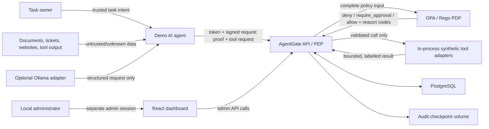

# AgentGate architecture

**Status:** educational local MVP implemented through Phase 9
**Security posture:** default deny; fail closed; the language model is never an
authorization authority

## Problem statement

An AI agent can be manipulated by its user, retrieved content, another agent, a
poisoned tool description, or its own stored context. Prompt instructions cannot
reliably enforce least privilege because the same model that interprets the
instruction may also be influenced to ignore it. AgentGate therefore places a
deterministic policy-enforcement point between the agent and every side-effecting
or data-access tool.

The architecture follows the Open Policy Agent separation between a policy
decision point (OPA) and a policy enforcement point (AgentGate). OPA evaluates
structured state; AgentGate owns authentication, validation, context assembly,
decision enforcement, adapter execution, and auditing. See the official
[OPA integration guidance](https://www.openpolicyagent.org/docs/integration) and
[OPA deployment model](https://www.openpolicyagent.org/docs/deploy).

## Security invariants

1. No adapter is reachable directly by an agent.
2. No identity, task, capability, tool risk, approval, rate, or provenance fact is
   trusted merely because the agent supplied it.
3. Authentication is proof-of-possession, not bearer token possession alone.
4. Capabilities are exact, task-scoped grants stored by AgentGate; absence means
   denial.
5. Unknown tools, invalid schemas, missing context, OPA errors, and indeterminate
   decisions fail closed.
6. `require_approval` is not an allow result. Only a fresh re-evaluation of the
   exact stored request may execute after approval.
7. Untrusted content can be data for a tool, but cannot independently confer
   authority to perform a sensitive action.
8. Executable adapters and strict schemas are static, version-controlled code.
   Neither model output nor a mutable description creates a tool.
9. Secrets, raw tokens, private workload keys, and full sensitive results do not
   enter logs or ordinary API responses.
10. Every security-relevant state transition is reconstructable from a redacted,
    integrity-protected audit sequence.

## System context



The API, PostgreSQL, OPA, and frontend run in separate containers. Only the API
and frontend development ports are published to the host. PostgreSQL and OPA are
on an internal Compose network and are not published by default. Tool adapters are
Python components inside the API process, not HTTP services, so there is no route
around the policy-enforcement point.

## Trust boundaries

| ID | Boundary | Data crossing | Primary controls |
| --- | --- | --- | --- |
| TB-1 | Task owner to agent | Goals and instructions | Task ownership, explicit capabilities, no direct tool access, approval for impact. |
| TB-2 | External content to agent | Documents, tickets, websites, email-like content, tool results | Server-assigned provenance, untrusted propagation, content treated as data, sensitive-action policy. |
| TB-3 | Agent to AgentGate | Token, proof, task/tool request, claimed influence IDs | TLS-ready HTTP boundary, size limit, JWT validation, Ed25519 request proof, replay cache, strict schemas. |
| TB-4 | AgentGate to OPA | Server-assembled policy input and decision response | Internal network, timeout, strict response schema, policy version, fail closed. |
| TB-5 | AgentGate to adapter | Validated typed arguments and execution context | Static registry, exact adapter map, timeout, sandbox root, query templates, result bounds. |
| TB-6 | Administrator to approval service | Admin credential and decision | Separate audience/role, origin restriction, exact approval binding, expiry, one-time consumption, audit. |
| TB-7 | Application to PostgreSQL | Security state and encrypted request payloads | Parameterized ORM, least-privilege DB role, constraints, transactions, encryption of recoverable payloads. |

Container boundaries reduce accidental exposure but are not treated as strong
hostile-tenant isolation in this local MVP.

## Components

### Demo agent

- Accepts a task and emits only structured `tool_name`, `arguments`, and referenced
  provenance-record IDs.
- Owns an Ed25519 private key in its local process; only the public key is
  registered with AgentGate.
- Requests a short-lived task token and signs every protected HTTP request.
- Calls no adapter, database, synthetic data directory, or OPA endpoint directly.
- The Phase 9 portfolio client demonstrates allow, deny, approval, execution, and
  audit verification through only the public API. It never prints credentials,
  full arguments, or tool results.
- The evaluation harness runs deterministically from scenario fixtures without
  Ollama. Optional Ollama output must pass the same strict request schema and has
  no extra authority.

### AgentGate API (policy enforcement point)

The API performs security operations in this order:

1. Enforce transport-level request size and content type.
2. Validate token signature, algorithm allowlist, issuer, audience, `iat`, `exp`,
   `jti`, subject, task ID, and key confirmation thumbprint.
3. Verify the per-request proof, body hash, method/path, timestamp window, access
   token hash, and one-time proof ID.
4. Load the agent, credential, task, exact capabilities, static tool metadata,
   approval, provenance, and current limit state from authoritative sources.
5. Validate the outer request and tool arguments with strict Pydantic models;
   unexpected fields are errors. Normalize accepted arguments and calculate their
   canonical hash.
6. Persist the request attempt and a redacted audit event, including attempts that
   will be denied.
7. Call the named OPA decision with the complete context. Strictly validate the
   response and apply precedence `deny > require_approval > allow`.
8. Deny, create an exact-bound pending approval, or call the single registered
   typed adapter under timeout and resource limits.
9. Sanitize and bound the result, persist final state, append audit events, and
   return a stable response envelope.

Internal errors become a generic error code and correlation ID. Raw exception
messages and stack traces are available only in redacted development diagnostics.

### Identity service

Identity is implemented as a bounded backend domain service, not as a second
network service in the MVP.

- `POST /agents` is admin-only and registers a display name plus public Ed25519
  JWK. The service calculates and stores a key thumbprint.
- `POST /agents/{agent_id}/tokens` requires a fresh request proof by that key and a
  task ID. Granted capabilities are copied from the stored task, never accepted
  from the request.
- Access tokens are server-signed JWTs with an algorithm allowlist and a maximum
  lifetime (target: five minutes). Required claims are `iss`, `aud`, `sub`,
  `task_id`, `capabilities`, `jti`, `iat`, `nbf`, `exp`, and `cnf.jkt`.
- Credential rows store a one-way hash of `jti`, not the encoded token. Revocation
  is checked on every request; agent or task deactivation also denies access.
- A request proof is a compact JWS signed by the workload key and covers method,
  path, canonical body hash, access-token hash, timestamp, and a unique proof ID.
  Used proof IDs are rejected. This is a deliberately small DPoP-like educational
  protocol, not a claim of standards-compliant DPoP.

The token-issuance proof has no access token to bind, so its narrowly defined
variant covers the method, path, canonical issuance body, timestamp, and unique
proof ID. All subsequent protected requests additionally cover the access-token
hash. The verifier selects the expected proof form from the endpoint; the caller
cannot downgrade it.

Binding the token to a key means copying one agent's token to another process is
insufficient to act as that agent. Host compromise that steals both token and
private key remains a residual risk.

### Policy engine (OPA)

AgentGate queries the single named Rego decision
`data.agentgate.authorization.decision`. Its response contract is:

```json
{
  "decision": "deny",
  "reason_codes": ["CAPABILITY_MISSING"],
  "policy_version": "1.0.0"
}
```

The decision is total: Rego defines an explicit default deny result. Multiple
applicable rules are resolved deterministically. Any deny reason wins; otherwise
an approval reason wins; allow is possible only when an allow rule applies and no
stronger outcome applies. Reason codes are stable identifiers, while optional
human-readable text is presentation metadata.

Every policy input contains at least:

```json
{
  "agent": {"id": "uuid", "status": "active"},
  "task": {"id": "uuid", "owner_id": "uuid"},
  "token": {
    "issuer": "agentgate.local",
    "audience": "agentgate-tools",
    "expected_issuer": "agentgate.local",
    "expected_audience": "agentgate-tools",
    "expires_at": "2026-08-11T10:05:00Z",
    "task_id": "uuid",
    "capabilities": ["tickets.read"],
    "revoked": false,
    "proof_valid": true
  },
  "tool": {"name": "tickets.read", "known": true, "risk": "low"},
  "request": {
    "arguments_valid": true,
    "arguments": {},
    "argument_hash": "sha256:...",
    "body_size_bytes": 123
  },
  "provenance": {
    "labels": ["untrusted"],
    "source_types": ["support_ticket"],
    "untrusted_influence": true,
    "trusted_intent_present": false
  },
  "approval": {
    "status": "none",
    "argument_hash": null,
    "expires_at": null,
    "consumed": false
  },
  "limits": {
    "rate_exceeded": false,
    "request_size_exceeded": false,
    "expected_response_size_exceeded": false
  },
  "now": "2026-08-11T10:00:00Z"
}
```

The policy input also includes request, approval, and credential identifiers for
correlation. Fields are generated or verified by AgentGate. An agent cannot set
`known`, `risk`, `arguments_valid`, `trusted_intent_present`, approval state, or
limit state.

OPA is queried over the internal network with a short HTTPX timeout. Timeout,
connection failure, an undefined result, an unknown outcome, a missing reason
code, or a response-schema error produces `POLICY_ENGINE_ERROR` and denies
execution. No cached allow is used in the MVP.

The initial policy reason-code catalog is intentionally small and testable:

| Outcome | Reason codes |
| --- | --- |
| Deny | `DEFAULT_DENY`, `AGENT_INACTIVE`, `CREDENTIAL_EXPIRED`, `CREDENTIAL_REVOKED`, `TOKEN_CONTEXT_INVALID`, `PROOF_INVALID`, `CAPABILITY_MISSING`, `UNKNOWN_TOOL`, `ARGUMENTS_INVALID`, `CROSS_TASK_CREDENTIAL`, `PROVENANCE_INVALID`, `UNTRUSTED_ONLY_SENSITIVE_INTENT`, `UNKNOWN_PROVENANCE_SENSITIVE_INTENT`, `APPROVAL_ARGUMENT_MISMATCH`, `APPROVAL_EXPIRED`, `APPROVAL_REPLAYED`, `RATE_LIMIT_EXCEEDED`, `RESOURCE_LIMIT_EXCEEDED`, `POLICY_ENGINE_ERROR` |
| Require approval | `HIGH_RISK_APPROVAL_REQUIRED`, `FILE_OVERWRITE_APPROVAL_REQUIRED` |
| Allow | `LOW_RISK_CAPABILITY_ALLOWED`, `MEDIUM_RISK_CAPABILITY_ALLOWED`, `APPROVAL_VALID` |

Authentication can reject a malformed token before an OPA call is safe to make,
but such attempts still receive a stable API reason and audit record. For a token
that is syntactically and cryptographically parseable, OPA receives the verified
claim context and independently enforces expiry, revocation, task, capability,
provenance, approval, and limit rules. Each policy rule receives a positive and
negative Rego unit test; default deny is tested with incomplete and novel input.

### Tool gateway

The executable registry is a fixed mapping from an exact tool name to:

- a strict Pydantic argument model (`extra="forbid"`),
- risk tier and required capability,
- timeout, request/result size, and rate limits,
- a single adapter function, and
- a result sanitizer and provenance labeller.

The registry contains no arbitrary command runner and never resolves a function
name from user input. Database rows mirror this manifest for joins and display;
startup compares a manifest checksum and fails if the security metadata diverges.

| Tool | Risk | Important containment |
| --- | --- | --- |
| `documents.search` | Low | Synthetic corpus only; bounded query/results; returned records labelled by source. |
| `tickets.read` | Low | Synthetic ticket ID allowlist; ticket body always labelled untrusted. |
| `email.create_draft` | Medium | Local mock mailbox; validated address; bounded subject/body; no delivery side effect. |
| `email.send` | High | Local simulated outbox; human approval always; recipient/subject/body covered by argument hash. |
| `files.read` | Medium | Relative paths only; canonical containment; symlink/reparse-point rejection; dedicated volume; bounded types/size. |
| `files.write` | High | Same containment; allowed extensions/size; atomic write; overwrite state captured before policy; approval required. |
| `database.query` | Medium | Exact query-template ID plus typed parameters; SQL text is never an input field. |

`asyncio.timeout` bounds adapter execution. Results are serialized only through a
declared response model and rejected or truncated according to a per-tool policy;
truncation is explicit in the response and audit event. The gateway never invokes
a shell with request data.

File containment performs lexical rejection and resolved-path containment for the
target and existing parent. Existing path components are checked for symlinks or
Windows reparse points. The Docker service receives only the dedicated sandbox
volume. Platform-specific no-follow primitives are used where available. These
controls reduce, but do not fully eliminate, filesystem time-of-check/time-of-use
races on every supported platform.

### Approval service

An initial high-risk request is stored before a pending approval is created. The
approval binds:

- approval ID and tool-request ID,
- agent ID and task ID,
- exact tool name,
- SHA-256 of canonical, validated arguments,
- request creation and approval expiry,
- status and one-time consumption timestamp.

Canonicalization happens after Pydantic normalization. The implementation uses a
defined canonical JSON representation: UTF-8, sorted object keys, no insignificant
whitespace, normalized JSON scalar types, and rejection of non-finite numbers.
The hash is formatted as `sha256:<lowercase hex>` and compared with
`hmac.compare_digest`.

Approval does not accept replacement arguments and does not call an adapter from
admin-supplied data. In one database transaction the service locks the pending
row, verifies admin authorization, binding, hash, expiry, and unused state, records
the approval action, re-evaluates OPA using the original encrypted request, and
marks the approval consumed before dispatch. A second approval or execution loses
the transaction race and is rejected. If execution fails, the approval remains
consumed and a new request is required.

### Provenance and trust service

Provenance labels are `trusted`, `untrusted`, and `unknown`; source types include
`user_instruction`, `local_configuration`, `external_document`, `website`,
`email`, `support_ticket`, `tool_output`, and `another_agent`.

- AgentGate assigns labels when it creates a task or returns adapter data.
- Support-ticket text, external documents, websites, email content, other-agent
  content, and derived content remain untrusted unless a separate deterministic
  administrative process changes their classification.
- The agent references provenance IDs that influenced a request. AgentGate loads
  the actual labels; it ignores agent-supplied label text.
- A derived record's trust is no greater than its least-trusted material input.
- A high-risk action with untrusted influence and no trusted task-owner intent is
  denied, not merely sent for approval. When trusted intent is present, normal
  capability and approval requirements still apply.

The service cannot prove that a compromised model disclosed every influence; the
demo-agent wrapper propagates IDs and the evaluation measures this control under
the defined protocol. Preventing omission by arbitrary third-party agents would
require stronger information-flow enforcement or isolating content/tool channels.

### Audit service

Audit events contain a monotonic sequence, event type, UTC time, correlation ID,
actor and task/request references, sanitized normalized argument summary and hash,
policy outcome/reasons/version, approval transition, execution outcome, latency,
previous event hash, and current event hash.

Recoverable full tool arguments required for an approved execution are stored
separately as authenticated ciphertext using a runtime key outside PostgreSQL.
The ordinary audit payload contains a redacted normalized representation and the
canonical hash. Bearer tokens, private keys, passwords, bootstrap secrets, and raw
sensitive tool results are never audit fields.

Each event hash is an HMAC-SHA-256 over the previous hash and canonical event
payload. After a committed append, the service atomically updates a separately
mounted checkpoint containing chain ID, sequence, head hash, and checkpoint MAC.
Verification checks canonical hashes, links, sequence continuity, the genesis
record, and the external checkpoint. This detects database-only modification,
insertion, deletion, reordering, and tail truncation in the threat model.

The API serializes appends through a PostgreSQL transaction/advisory lock so two
writers cannot fork the chain. `/audit/verify` and `scripts/verify_audit.py` use
the same read-only verifier. This is tamper-evident, not tamper-proof: compromise
of the API plus audit key and checkpoint volume can forge a new chain. Production
would anchor signed heads in an external immutable service.

### Security dashboard

The React/TypeScript frontend is an admin-only view of:

- agent/task status and granted exact capabilities,
- allowed, denied, pending, and completed tool requests,
- reason codes and policy versions,
- pending approval summaries with sensitive bodies replaced by length/hash,
- redacted audit timeline and latest verification result,
- measured evaluation results and security metrics.

It never displays raw workload/admin credentials, private keys, encrypted request
payloads, full email bodies, or full sensitive tool results. CORS permits only the
configured local frontend origin. Security headers include a restrictive CSP,
`nosniff`, frame denial, referrer restriction, and no-store caching on sensitive
responses.

### Delivery and assurance pipeline

Phase 9 separates independently reviewable gates for backend tests/coverage,
strict typing/lint, Bandit and dependency audit, frontend lint/test/build/audit,
OPA rule coverage, CodeQL for Python and TypeScript, and a clean Compose startup.
The Compose gate uses ephemeral secrets, waits for service health, exercises both
host API and frontend proxy routes, persists an evaluation, runs the proof-bound
demo, and always destroys its volumes. External actions and the downloaded OPA
binary are commit/checksum pinned. Dependabot proposes bounded weekly updates;
updates still require the same gates.

## High-risk request sequence

```mermaid
sequenceDiagram
    participant A as "Agent"
    participant G as "AgentGate"
    participant D as "PostgreSQL"
    participant P as "OPA"
    participant H as "Administrator"
    participant T as "Tool adapter"

    A->>G: "Signed email.send request"
    G->>G: "Authenticate, verify proof, validate, hash"
    G->>D: "Store request + provenance + audit"
    G->>P: "Complete authorization input"
    P-->>G: "require_approval + HIGH_RISK_TOOL"
    G->>D: "Create exact-bound pending approval"
    G-->>A: "202 pending + request ID"
    H->>G: "Approve approval ID"
    G->>D: "Lock request/approval; verify unused and unexpired"
    G->>P: "Re-evaluate original request with approval context"
    P-->>G: "allow + APPROVAL_VALID"
    G->>D: "Consume approval atomically + append audit"
    G->>T: "Execute server-stored typed arguments"
    T-->>G: "Bound synthetic result"
    G->>D: "Persist outcome + append audit/checkpoint"
    G-->>H: "Sanitized execution status"
    A->>G: "Poll tool-request ID"
    G-->>A: "Sanitized final status/result"
```

## Data model

The initial normalized schema uses UUID primary keys and UTC timestamps unless
noted otherwise.

| Table | Purpose and security-relevant fields |
| --- | --- |
| `administrators` | Local admin identity, status, password/verifier hash or external subject, timestamps; never a plaintext admin secret. |
| `agents` | Stable identity, status, display name, public JWK, key thumbprint, timestamps. |
| `agent_credentials` | Agent/task references, hashed token ID, issued/expiry times, key thumbprint, status; never the encoded token. |
| `request_proofs` | Credential/agent reference, hashed one-time proof ID, proof time and expiry; uniqueness enforces replay rejection. |
| `revocations` | Credential or agent reference, reason code, revoker, effective time. |
| `tasks` | Owner, assigned agent, trusted instruction hash/summary, status, start/expiry times. |
| `task_capabilities` | Unique task + exact capability grant; no wildcard. |
| `tool_registry` | Static manifest mirror: exact name, risk, schema/adapter version, enabled flag, checksum. |
| `tool_requests` | Agent/task/tool, encrypted normalized arguments, redacted summary, argument hash, status, sizes, timestamps. |
| `policy_decisions` | Request, OPA decision ID, outcome, reason codes, policy version, redacted input hash, latency. |
| `approval_requests` | Exact binding fields, status, expiry, consumption time, optimistic version. |
| `approval_actions` | Approval, admin actor, approve/reject action, reason, timestamp; append-only application flow. |
| `provenance_records` | Task/request, source type/reference, trust label, parent record, content hash, creator, timestamp. |
| `tool_request_influences` | Exact many-to-many bindings from a tool request to the authoritative provenance records declared to have influenced it. |
| `audit_events` | Monotonic sequence, event metadata/payload, previous hash and HMAC event hash. |
| `evaluation_runs` | Versioned scenario-set/config hashes, start/end, aggregate measured metrics. |
| `evaluation_results` | Run/scenario and legitimate/adversarial kind, expected/actual outcome and reason, pass flag, policy/enforcement latency, audit completeness, and chain-verification status. |

Foreign keys, enum/check constraints, uniqueness constraints, non-null security
fields, and indexes on lookup/expiry/status columns enforce invariants in addition
to service checks. Approval state changes and audit append operations use explicit
transactions and row/advisory locks.

## API authorization classes

| Class | Example endpoints | Required principal |
| --- | --- | --- |
| Public operational | `GET /health` | None; response deliberately minimal. |
| Workload | `POST /agents/{id}/tokens`, `POST /tool-requests`, `GET /tool-requests/{id}` | Agent proof; resource must match agent/task. |
| Administrative | `POST /agents`, `GET /agents`, `POST /tasks`, revocation, approval actions, audit/metrics queries | Separate admin session/audience. |

The initial REST contract is:

| Method and path | Principal | Behavior |
| --- | --- | --- |
| `POST /admin/session` | Bootstrap/admin verifier | Issues a short local admin session with an admin-only audience; never accepts an agent token. |
| `POST /agents` | Admin | Registers an agent's public JWK and returns its stable ID, status, and key thumbprint. |
| `GET /agents` | Admin | Lists sanitized agent status; no credentials or complete keys. |
| `POST /agents/{agent_id}/tokens` | Agent key proof | Issues a short task token from stored task grants; returns the encoded token once. |
| `POST /agents/{agent_id}/revoke` | Admin | Deactivates/revokes with a reason and effective time; it does not delete history. |
| `POST /tasks` | Admin | Creates owner-bound trusted task intent and exact capabilities. |
| `GET /tasks/{task_id}` | Admin or owning agent | Returns a role-appropriate sanitized task view. |
| `POST /tool-requests` | Agent token + request proof | Records, authorizes, and either denies, executes, or creates a pending approval. |
| `GET /tool-requests/{request_id}` | Admin or owning agent | Returns a role-appropriate status/result summary. |
| `GET /approvals` | Admin | Lists pending/recent approvals with argument hashes and redacted summaries. |
| `POST /approvals/{approval_id}/approve` | Admin | Atomically approves, reauthorizes, consumes, and dispatches the exact stored request. |
| `POST /approvals/{approval_id}/reject` | Admin | Atomically rejects a pending request and records the reason. |
| `GET /audit/events` | Admin | Returns a paginated, redacted timeline with chain metadata. |
| `POST /audit/verify` | Admin | Verifies the complete chain and external checkpoint without mutating events. |
| `GET /metrics/security` | Admin | Returns measured persisted counts/rates; it does not invent missing evaluation metrics. |
| `GET /health` | Public | Returns minimal liveness/readiness and dependency status. |

Additional evaluation-report endpoints may be added without changing the
privilege separation. Errors use one envelope:

```json
{
  "error": {
    "code": "CAPABILITY_MISSING",
    "message": "The request is not authorized.",
    "request_id": "uuid"
  }
}
```

Messages are safe and stable; internal errors and policy inputs are not reflected.

## Security decisions and trade-offs

| Decision | Benefit | Cost / limitation |
| --- | --- | --- |
| Proof-bound JWT plus one-time request JWS | Demonstrates workload identity and limits stolen bearer-token use. | More protocol/test complexity; not advertised as full DPoP or mTLS. |
| OPA sidecar/service with fail-closed HTTP call | Policies are inspectable/testable and outside the model. | OPA outage denies all tool operations; MVP does not cache allows. |
| Static in-process adapters | No direct network bypass and a small, auditable execution surface. | Adding a tool requires a code release; dynamic MCP discovery is out of scope. |
| PostgreSQL for integration tests | Tests production-like constraints, locking, and transaction behavior. | Docker is needed for the integration suite. |
| Encrypted original arguments plus redacted audit form | Exact approvals remain executable without exposing content in logs. | Runtime encryption-key compromise exposes stored payloads. |
| Keyed chain plus separate checkpoint | Detects database-only chain rewriting and truncation. | Not immutable against combined application/key/volume compromise. |
| No cached authorization | Simple, correct fail-closed behavior. | Reduced availability when OPA is unhealthy. |
| Server-assigned provenance with explicit influence IDs | Makes indirect-injection controls measurable and deterministic. | A malicious third-party agent may omit an influence ID. |
| High-risk actions always require approval | Clear, defensible MVP safety rule. | More friction and no contextual risk reduction in the initial release. |

## Secure defaults and operational limits

Numeric values are configurable and covered by tests. The implemented safe
defaults use a five-minute token lifetime, short proof-clock skew, approval
expiry measured in minutes, per-tool calls-per-minute limits, a small API request
body ceiling, per-tool response ceilings, and adapter timeouts measured in
seconds. Configuration must reject zero, negative, or unreasonably large values.

Development secrets live in an ignored `.env`; `.env.example` contains only fake
values and key-generation instructions. Container services run as non-root where
practical, use read-only filesystems except named data volumes, and receive only
the secrets required by that service.

## References

- [OWASP AI Agent Security Cheat Sheet](https://cheatsheetseries.owasp.org/cheatsheets/AI_Agent_Security_Cheat_Sheet.html)
- [OWASP Agentic AI: Threats and Mitigations](https://genai.owasp.org/resource/agentic-ai-threats-and-mitigations/)
- [Open Policy Agent documentation](https://www.openpolicyagent.org/docs)
- [Open Policy Agent REST API](https://www.openpolicyagent.org/docs/rest-api)
