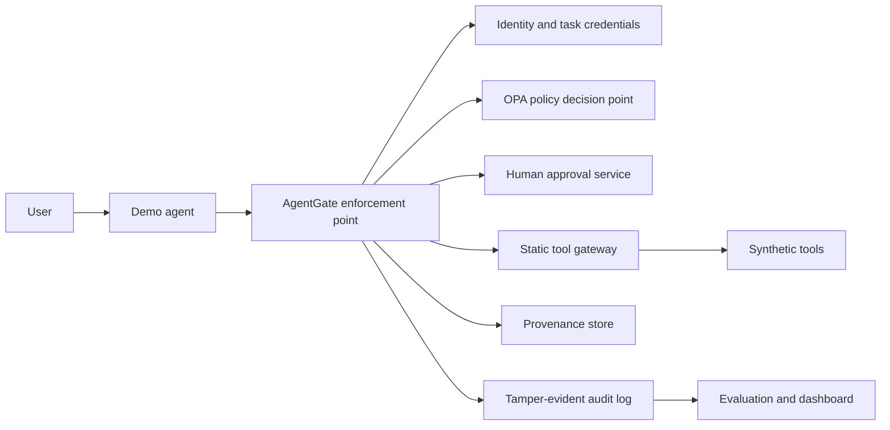

# Phase 0 explained: security design before implementation

Phase 0 established the security contract for AgentGate before any runtime code
was written. Its purpose was to turn a broad idea—placing a Zero Trust control
plane between an AI agent and its tools—into a bounded, testable system design.

**Phase status:** complete
**Primary outputs:** implementation plan, reference architecture, and STRIDE
threat model
**Runtime code delivered:** none

## 1. The problem Phase 0 defined

An AI agent can generate useful plans, but its language model is probabilistic,
promptable, and exposed to untrusted content. AgentGate therefore treats the
model as an untrusted requester rather than an authorization authority.

The core security invariant is:

> No tool call is executed solely because the model requested it. Every call
> must pass deterministic identity, capability, policy, approval, provenance,
> and audit controls outside the model.

That principle shaped every later phase. The agent may propose an action, but it
cannot mint its own permissions, change policy, approve its own request, select
the adapter implementation, or bypass the enforcement point.

## 2. Scope and non-goals

Phase 0 deliberately constrained the first version to a local educational MVP.
The planned system uses synthetic, statically registered tools and local
services so that the security behavior can be studied without risking real
email, cloud, payment, or operating-system accounts.

The MVP scope includes:

- a demo agent that can request predefined tools;
- a single AgentGate policy-enforcement path for every tool request;
- workload identity and task-scoped credentials;
- deterministic authorization through Open Policy Agent (OPA);
- human approval for sensitive, high-risk, or ambiguous actions;
- provenance tracking for untrusted data;
- tamper-evident audit events and adversarial evaluations; and
- a small dashboard for inspecting requests and decisions.

The initial design explicitly excludes:

- production multi-tenancy and internet-scale deployment;
- direct access to arbitrary shell, Python, SQL, or network execution;
- real third-party accounts or consequential external systems;
- enterprise identity federation, hardware-backed key custody, and HSMs;
- treating an LLM-generated answer as a policy decision; and
- claiming that a local demonstration is a production security product.

These boundaries reduce blast radius and make each security claim observable.

## 3. Reference architecture

Phase 0 divided AgentGate into components with narrow responsibilities:

The model-facing agent is intentionally separated from the security-critical
services. The policy-enforcement point (PEP) assembles trusted context, asks OPA
for a decision, obtains approval where required, dispatches only through a
known adapter, and records the result.

The policy decision point (PDP) is deterministic. It receives structured input
and returns one of a small number of outcomes such as `allow`, `deny`, or
`require_approval`, together with stable reason codes. It never executes the
tool itself.

## 4. Trust boundaries and data flow

The design identified several trust boundaries that later code must preserve:

1. **User to agent.** User intent is input, not a fully validated capability.
2. **Untrusted content to agent.** Documents and tool output can contain prompt
   injection and must retain provenance labels.
3. **Agent to AgentGate.** Requests require an authenticated workload identity,
   an assigned task, exact capabilities, and a fresh proof of possession.
4. **AgentGate to OPA.** The PEP must provide complete trusted context and fail
   closed if OPA is unavailable or returns an invalid response.
5. **AgentGate to a tool adapter.** Only a server-selected adapter from a static
   registry may run; the model cannot supply executable code or a target URL.
6. **Sensitive request to human approver.** Approval must bind to the exact
   request and cannot be replayed for changed arguments.
7. **Runtime to audit storage.** Security-relevant events must be structured,
   ordered, redacted, and tamper-evident.

This analysis made it possible to define controls at the boundary where they
are effective instead of relying on prompting conventions.

## 5. Security decisions made in Phase 0

### The model is non-authoritative

The model may express intent, but all identity, capabilities, task assignments,
policy inputs, approval facts, and adapter selection come from trusted server
state. This prevents prompt injection from becoming an authorization primitive.

### Credentials are short-lived and proof-bound

The design selected short-lived JWT workload credentials whose capabilities are
derived from persisted task grants. Each protected request also carries a
signed, one-time proof bound to the method, path, body, and access token. A
stolen bearer token alone is therefore insufficient.

### Capabilities are exact

Capabilities name specific operations. Wildcards are prohibited because broad
grants make least-privilege review and policy reasoning unreliable.

### Authorization is default-deny and fail-closed

OPA supplies deterministic rules outside the model. Missing data, unknown
tools, malformed responses, timeouts, and policy-service failures result in
denial or an unavailable dependency—not an implicit allow.

### Tool adapters are static

Tools are registered by trusted code with typed argument schemas, timeouts,
output limits, and side-effect classifications. The agent cannot choose an
arbitrary executable, import path, host, or command.

### Approval binds to the exact action

An approval applies to the stored request's agent, task, tool, and canonical
argument hash. Modifying the request invalidates the approval, and an approval
record is one-time and time-limited.

### Provenance follows data

Data obtained from untrusted sources must remain labelled as it moves through
the system. Policy can then prevent untrusted instructions or sensitive values
from being used in dangerous sinks without an appropriate control.

### Auditability is a security feature

The design called for append-oriented events linked by an HMAC chain. Sensitive
values are redacted or represented by digests, allowing investigators to check
event ordering and integrity without turning the audit log into a credential
store.

## 6. STRIDE threat analysis

The Phase 0 threat model applied STRIDE to concrete AgentGate assets and flows:

- **Spoofing:** forged agents, stolen tokens, or substituted public keys;
- **Tampering:** changed arguments, policy input, approvals, or audit events;
- **Repudiation:** actions without a trustworthy identity and decision trail;
- **Information disclosure:** secrets in logs, tokens, errors, or tool output;
- **Denial of service:** oversized requests, expensive policy input, or stuck
  tools; and
- **Elevation of privilege:** self-asserted capabilities, wildcard access,
  cross-task use, prompt injection, or arbitrary adapter execution.

For each category, the model documented assets, attack paths, preventive and
detection controls, residual risk, and the phase in which the control would be
implemented. This made the threat model an engineering backlog rather than a
generic checklist.

## 7. The gated implementation sequence

Phase 0 divided delivery into small, reviewable gates:

1. **Phase 0 — design:** architecture, boundaries, threats, and acceptance gates.
2. **Phase 1 — foundation:** API lifecycle, configuration, logging, middleware,
   PostgreSQL schema, migrations, and container hardening.
3. **Phase 2 — identity and policy:** agent identity, task grants, proof-bound
   credentials, revocation, and OPA rules.
4. **Phase 3 — tool mediation:** static registry, strict schemas, seven safe
   adapters, execution limits, and request records.
5. **Phase 4 — approval:** exact-request, one-shot approval with expiry and
   substitution protection.
6. **Phase 5 — provenance:** server-assigned labels and taint propagation.
7. **Phase 6 — audit integrity:** keyed event chain, external checkpoint, and
   verification API/CLI.
8. **Phase 7 — evaluation:** at least 50 measured legitimate and adversarial
   scenarios with generated reports.
9. **Phase 8 — dashboard:** administrative views for identities, requests,
   approvals, audit status, and metrics.
10. **Phase 9 — hardening:** CI, scans, Compose verification, and complete
    documentation.

Each phase must preserve the earlier invariants and pass its own tests before a
more consequential execution surface is introduced.

## 8. Phase 0 deliverables

- [MVP and phased implementation plan](phase-0-plan.md) defines scope,
  assumptions, acceptance criteria, repository layout, and delivery gates.
- [Security architecture](architecture.md) documents components, trust
  boundaries, data flows, controls, and explicit trade-offs.
- [STRIDE threat model](threat-model.md) connects identified threats to planned
  mitigations, tests, and residual risks.

Phase 0 intentionally delivered no API, database, identity, policy, or tool
runtime. Its success criterion was a coherent security design that could guide
implementation and be challenged before code increased the cost of change.

## 9. How Phase 0 prepared Phase 1

The design identified the foundation needed before credentials or tools could
exist: safe configuration, redacted structured logging, trustworthy request
correlation, bounded inputs, stable errors, dependency-aware health checks, a
normalized schema, reversible migrations, and hardened local containers.

That ordering matters. Identity and policy decisions are only as trustworthy as
the configuration, persistence, and observability beneath them. Phase 1 built
that base from the constraints established here.

## 10. What this phase demonstrates

Phase 0 demonstrates security architecture as an engineering activity: defining
assets and trust boundaries, separating policy from execution, translating a
threat model into testable controls, documenting residual risk, and sequencing
delivery so that dangerous capabilities do not arrive ahead of their safeguards.
