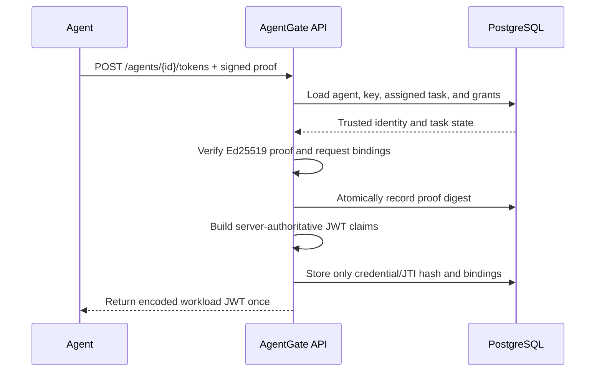

# Phase 2 explained: workload identity and deterministic authorization

Phase 2 added the identity and policy layers that allow AgentGate to answer two
questions before any tool can run: **who is asking?** and **is this exact action
permitted in this exact context?**

It implements administrator/workload separation, strict Ed25519 identity
registration, task-assigned capabilities, short-lived proof-bound JWTs,
one-time request proofs, immediate revocation, and a fail-closed OPA policy
client with a default-deny Rego policy.

**Phase status:** complete
**Primary objective:** authenticate agents and make deterministic authorization
decisions outside the language model
**Current verification:** 111 passed, 1 live-PostgreSQL test skipped, 89.71%
branch-aware Python coverage; 23/23 Rego tests and 100% Rego rule coverage

## 1. Security invariants

Phase 2 enforces these central invariants:

- an agent cannot register a private key with AgentGate;
- an agent cannot choose or widen its own capabilities;
- a credential is valid only for its assigned agent and task;
- a token is short-lived, audience-specific, and bound to an Ed25519 key;
- possession of the token alone is not sufficient for a protected request;
- each request proof is bound to the request and can be used only once;
- persisted agent, task, credential, and revocation state is checked live;
- administrator and workload tokens cannot be substituted for one another;
- OPA decisions are deterministic, default-deny, and subordinate to hard-deny
  conditions; and
- an unavailable or malformed policy response never becomes an allow.

## 2. Layered implementation

Identity code is separated by responsibility:

- [backend/app/auth](../backend/app/auth) handles cryptographic primitives,
  token encoding/decoding, proof parsing, and canonical hashes;
- [backend/app/db/identity.py](../backend/app/db/identity.py) owns persistence
  queries and transactional replay checks;
- [backend/app/services/identity.py](../backend/app/services/identity.py)
  coordinates trusted server state and protocol rules; and
- [backend/app/api/identity.py](../backend/app/api/identity.py) exposes strict
  request/response models and maps safe domain failures to API errors.

OPA communication is isolated in
[backend/app/policies/client.py](../backend/app/policies/client.py), while the
policy itself lives in [policies/agentgate.rego](../policies/agentgate.rego).

This separation keeps HTTP parsing, persistence, cryptography, and policy from
silently taking over one another's responsibilities.

## 3. Local administrator session

`POST /admin/session` exchanges the configured bootstrap secret for a
short-lived administrator token.

The bootstrap comparison uses a derived verifier and constant-time comparison,
not a direct ordinary string comparison. The configuration value is held in a
secret wrapper, and the service records only safe verifier metadata.

Administrator tokens use a distinct audience, `agentgate-admin`. Workload
tokens use the separate audience `agentgate-tools`. Every protected endpoint
requires the appropriate audience, so a valid token from one plane cannot be
reused in the other.

This bootstrap flow is intentionally local and educational. It is not a
replacement for enterprise administrator identity, MFA, federation, or
hardware-backed signing.

## 4. Agent registration

An administrator registers an agent at `POST /agents` using a public JSON Web
Key (JWK). Validation accepts only the exact public Ed25519 shape:

- `kty` must be `OKP`;
- `crv` must be `Ed25519`;
- `x` must be a correctly encoded 32-byte public key;
- private parameter `d` is forbidden; and
- unknown fields are rejected.

AgentGate calculates the RFC 7638 JWK thumbprint from the canonical public
members. This thumbprint becomes the stable confirmation key identifier used to
bind workload credentials and proofs.

Private keys never enter the service or database. They remain with the agent,
which is necessary for proof of possession to mean anything.

## 5. Server-authoritative tasks and capabilities

An administrator creates a task at `POST /tasks`, assigns exactly one agent,
and supplies the task's allowed capabilities. Task instructions are encrypted
with AES-256-GCM before persistence.

Capabilities use constrained exact names and cannot contain wildcard grants.
During token issuance, the server loads the task grants from the database. It
does not accept a caller-provided capability list. The credential therefore
cannot be broader than the task configured by the administrator.

Migration
[0002_task_agent_assignment.py](../backend/migrations/versions/0002_task_agent_assignment.py)
added the task assignment foreign key and index. The column is migration-safe
for existing rows, while the service requires assignment for all newly created
tasks.

## 6. Workload credential format

AgentGate issues an EdDSA-signed JWT after a valid agent proof. The token has a
fixed algorithm, type, key identifier, issuer, and workload audience. Its claims
include:

- `sub`: registered agent identity;
- `task_id`: the one assigned task;
- `caps`: capabilities loaded from persisted task grants;
- `jti`: a random token identifier;
- `iat`, `nbf`, and `exp`: bounded validity times; and
- `cnf.jkt`: the registered Ed25519 JWK thumbprint.

The default lifetime is five minutes. Parsing fixes the accepted algorithm and
validates issuer, audience, times, types, identifiers, and confirmation claim.
This avoids algorithm confusion and cross-audience substitution.

The encoded JWT is returned once and is never stored. Persistence contains a
hash of the token identifier plus status and binding facts. Every protected use
must also verify live database state, so disabling an identity or revoking a
credential takes effect without waiting for token expiry.

## 7. Request proof of possession

The agent signs a compact JWS with its Ed25519 private key and sends it in
`X-Agent-Proof`. The proof has a dedicated type and short lifetime, and includes
bindings for:

- HTTP method (`htm`);
- normalized request target (`htu`);
- canonical JSON body hash (`body_hash`);
- agent subject (`sub`);
- issued-at and expiry times;
- a fresh proof identifier (`jti`); and
- the encoded access-token hash (`ath`) for token-protected requests.

The initial token-issuance proof omits `ath` because no access token exists yet.
Subsequent protected calls require it. Changing the method, route, body, subject,
or token causes verification to fail.

Canonical JSON hashing gives the client and server a deterministic body digest
without signing transport-specific whitespace. Proofs expire after a narrow
window—30 seconds by default.

After cryptographic verification, the service records a proof digest under a
database uniqueness constraint in the same transactional flow. Reusing the same
proof therefore fails even under concurrent requests.

## 8. Token issuance flow

The full issuance flow is:

Issuance fails for inactive identities, disabled keys, task mismatch, invalid
or replayed proofs, malformed request bindings, or missing assignments.

## 9. Revocation and live-state validation

An administrator revokes an agent through
`POST /agents/{agent_id}/revoke`. The operation updates active status and appends
a revocation fact rather than deleting history.

Credential validation checks the presented token and its persisted state on
every protected request. The checks include the agent, public key, task
assignment, credential status, expiry, and revocation facts. Previously issued
tokens are therefore rejected immediately after revocation even if their
cryptographic expiry is still in the future.

This stronger guarantee costs a database read on protected operations. For the
educational local runtime, immediate revocation and clear semantics are worth
that trade-off.

## 10. Identity API surface

Phase 2 exposes:

- `POST /admin/session` — create a local administrator session;
- `POST /agents` — register a public Ed25519 workload identity;
- `GET /agents` — list registered agents without private material;
- `POST /tasks` — create an agent-assigned task with exact capabilities;
- `GET /tasks/{task_id}` — retrieve authorized task metadata;
- `POST /agents/{agent_id}/tokens` — issue a short-lived proof-bound workload
  credential; and
- `POST /agents/{agent_id}/revoke` — disable the identity and append revocation
  state.

Request models reject extra fields, malformed identifiers, invalid key shapes,
and capability syntax errors. Responses do not expose encrypted instructions,
token hashes, proof hashes, or private key material.

## 11. OPA policy service

OPA 1.18.2 runs as an internal, pinned static image and loads the AgentGate Rego
policy. The Python client posts a bounded structured input document to the
configured decision path and expects a strictly shaped result.

The policy input is intended to contain the complete trusted decision context:
identity and task state, token and proof validation facts, requested tool and
arguments, capability match, side-effect and risk classifications, provenance,
approval facts, and rate/resource facts.

The client applies timeouts and response-size limits. Connection failure,
timeout, non-success status, invalid JSON, missing result, unknown outcome, or
schema mismatch returns a synthetic `deny` result with the stable
`POLICY_ENGINE_ERROR` reason. The readiness dependency separately checks OPA's
health endpoint.

## 12. Rego decision model

The policy returns a stable outcome and reason codes. Its precedence is:

1. any hard-deny condition wins;
2. otherwise an approval requirement wins;
3. only then may a fully satisfied request be allowed.

Hard-deny rules cover conditions such as:

- inactive identity or task;
- invalid or expired token context;
- revoked credentials;
- invalid proof of possession;
- cross-task access;
- missing exact capability;
- unknown tools or invalid arguments;
- untrusted data entering a sensitive sink;
- mismatched, expired, or replayed approval;
- exceeded rate limits; and
- exceeded resource limits.

High-risk actions and file-overwrite-style effects require approval when no hard
deny applies. Low- and medium-risk requests may be allowed when every required
fact is valid. A valid exact approval can allow an otherwise approval-gated
request, but it cannot override a hard denial.

Unknown or incomplete input is denied by default. A valid exact approval can
permit a high-risk request when every base authorization condition is already
satisfied; it cannot override a hard denial.

## 13. Cryptographic and configuration separation

The workload signing key and task-instruction encryption key are independent
32-byte secrets with different purposes. The bootstrap secret is separate again.
Known values from `.env.example` are deliberately rejected in production mode.

This separation limits the effect of one key's disclosure and avoids ambiguous
key reuse. It does not create hardware protection: in the local MVP, server
keys still exist in process configuration and must be protected accordingly.

## 14. Verification performed in Phase 2

The completed gate produced the following evidence:

- 111 passing Python tests;
- 1 skipped live PostgreSQL migration test because Docker/PostgreSQL was not
  available in the execution environment;
- 89.71% branch-aware Python coverage;
- 23 of 23 Rego policy tests passing;
- 100% reported Rego rule coverage;
- a passing real OPA HTTP integration test;
- clean Ruff, strict MyPy, and Bandit runs;
- successful dependency consistency and bytecode compilation checks;
- successful offline migration upgrade and downgrade generation; and
- a clean vulnerability audit after upgrading `cryptography` to 50.0.0 in
  response to an advisory detected during the gate.

Tests exercise strict JWK handling, thumbprints, canonical hashes, token claim
validation, audience separation, proof bindings, expiry, replay, task
assignment, encrypted instructions, revocation, repository transactions,
configuration rejection, OPA client failure modes, policy precedence, and
readiness behavior.

The full live Compose/PostgreSQL gate was not run because the environment did
not provide Docker. That limitation remains explicit.

## 15. What Phase 2 does not yet do

Phase 2 can authenticate an agent and evaluate authorization policy, but it does
not expose or execute tool calls. In particular, it does not yet implement:

- the tool-request endpoint and end-to-end PEP orchestration;
- static adapter dispatch and typed tool argument execution;
- one-time human approval workflows;
- provenance propagation across tool results;
- HMAC-chained runtime audit behavior;
- adversarial evaluation runners; or
- the operator dashboard.

The OPA input and rules are ready for the enforcement path, but Phase 3 must
ensure the server—not the model—constructs that input and obeys the decision.

## 16. Residual risks and trade-offs

- The local bootstrap secret is suitable for a demonstration, not enterprise
  administration.
- Server signing and encryption keys are software-held rather than protected by
  an HSM or external key service.
- Theft of both an encoded token and the corresponding agent private key can
  satisfy proof of possession until live state or expiry blocks them.
- A database check per protected request favors immediate revocation over
  maximum throughput.
- Internal service HTTP relies on the local/container trust boundary; a
  production deployment would normally add stronger service identity and
  transport protection.
- Policy correctness depends on the enforcement point supplying complete,
  server-derived facts.

These are documented limitations, not hidden assumptions.

## 17. How Phase 2 prepares Phase 3

Phase 3 can now receive a tool request with a verified workload identity,
assigned task, exact capabilities, fresh request proof, live revocation state,
and a deterministic OPA decision. It can focus on the remaining enforcement
responsibilities: strict tool schemas, static adapter selection, bounded
execution, result handling, and durable request/decision records.

The detailed wire contract is documented in the
[identity and request-proof protocol](identity-protocol.md).

## 18. What this phase demonstrates

Phase 2 demonstrates backend and AI-security techniques working together:
public-key workload identity, proof-of-possession, audience isolation,
server-authoritative authorization, replay-safe transactions, immediate
revocation, encrypted task data, policy-as-code, denial precedence, fail-closed
dependency handling, and adversarial tests for both protocol and policy logic.
