# Phase 4 explained: exact-request human approval

Phase 4 completes the high-risk path that Phase 3 intentionally stopped at
`pending_approval`. An authenticated workload can request a high-risk synthetic
tool, but only a separately authenticated administrator can release that exact
request. Approval is short-lived, bound to a canonical argument hash, rechecked by
OPA, and consumed once before the adapter runs.

**Phase status:** complete
**Implemented endpoints:** `GET /approvals`,
`POST /approvals/{approval_id}/approve`, and
`POST /approvals/{approval_id}/reject`
**Security objective:** an administrator's approval of request A must never
authorize request B, even if B differs by only one character.

## 1. What changed from Phase 3

Phase 3 already validated and encrypted every request, calculated a canonical
argument hash, and asked OPA for one of three outcomes. Its high-risk branch
persisted `pending_approval` but deliberately had no way to continue.

Phase 4 adds the continuation:

1. A `require_approval` decision creates an `approval_requests` row.
2. The row copies the tool-request ID, agent ID, task ID, exact tool name, and
   canonical argument hash.
3. An administrator lists only a redacted summary and that hash.
4. Approval requires the administrator to echo the exact displayed hash. It does
   not accept recipient, subject, body, file content, or other replacement tool
   arguments.
5. AgentGate locks the approval and tool request, authenticates the encrypted
   original arguments, validates them again, recomputes the hash, reloads live
   identity/capability/registry state, and re-runs OPA.
6. If OPA returns the narrowly expected `allow` with `APPROVAL_VALID`, AgentGate
   marks the approval consumed and commits that fact before dispatch.
7. Any later approval attempt loses the state race and returns
   `APPROVAL_REPLAYED`.

The high-risk adapter is therefore still behind the same policy-enforcement point
as every Phase 3 action. The approval endpoint is not a shortcut around it.

## 2. Lifecycle and transaction boundary

```mermaid
stateDiagram-v2
    [*] --> Pending: "OPA require_approval"
    Pending --> Expired: "TTL elapsed"
    Pending --> Rejected: "administrator rejects"
    Pending --> Approved: "lock + exact binding verified"
    Approved --> Consumed: "OPA allow + commit before dispatch"
    Consumed --> [*]: "succeeded or failed; never reusable"
    Rejected --> [*]
    Expired --> [*]
```



`Approved` is an internal transition inside the locked approval transaction. It
is not a stable state that another HTTP request can observe and exploit. Approval
and consumption occur in the same transaction; dispatch occurs only after the
transaction commits.

This ordering creates an intentional failure rule: if the adapter fails after
consumption, the approval stays consumed. Retrying requires a completely new
workload request and a new human decision. At-most-once authorization is safer
than silently replaying a high-impact action whose external outcome might be
ambiguous.

PostgreSQL `SELECT ... FOR UPDATE` locks both the approval row and its tool-request
row. Two administrators can click approve concurrently, but only one transaction
can transition `pending` to `consumed`; the other observes a terminal state and
fails with `APPROVAL_REPLAYED`.

## 3. Exact binding and canonical hashing

The approval binding contains:

| Field | Purpose |
| --- | --- |
| `approval.id` | Identifies this one decision object. |
| `tool_request_id` | Prevents applying the approval to another persisted request. |
| `agent_id` | Prevents transferring authority to another workload identity. |
| `task_id` | Keeps authority inside the original trusted task. |
| `tool_name` | Prevents approving one adapter and executing another. |
| `argument_hash` | Binds every normalized argument value and object key. |
| `expires_at` | Makes unattended approvals short-lived. |
| `status`, `consumed_at`, `row_version` | Enforces a one-way, one-use lifecycle. |

Hashing occurs after strict Pydantic validation and normalization. AgentGate
serializes the normalized JSON as UTF-8 with sorted object keys, compact
separators, and no non-finite numbers, then formats SHA-256 as
`sha256:<64 lowercase hexadecimal characters>`.

Comparisons of stored and submitted hashes use `hmac.compare_digest`. The
approval service checks all of the following before OPA can authorize execution:

- the administrator-confirmed hash equals the approval hash;
- the approval hash equals the persisted tool-request hash;
- decrypting the original AES-256-GCM ciphertext succeeds with the tool-request ID
  as associated data;
- strict validation of that decrypted JSON succeeds again;
- a fresh canonical hash of the normalized decrypted arguments equals both stored
  hashes;
- agent, credential, task assignment, tool, risk, registry checksum, capability,
  and key-thumbprint bindings still match.

Only the `PreparedArguments` rebuilt from that authenticated ciphertext reaches
the gateway. The administrator cannot inject alternate arguments through the
approval API.

## 4. One-character substitution demonstration

The test suite exercises this invariant at three layers:

1. The administrator changes one hexadecimal character in the hash submitted to
   the approve endpoint. AgentGate returns `APPROVAL_ARGUMENT_MISMATCH`; the
   approval remains pending and the mailbox count remains zero.
2. A test replaces the encrypted stored email body with a validly encrypted value
   that differs by one character while leaving the original approval hash intact.
   Decryption and schema validation succeed, but canonical re-hashing differs, so
   execution is rejected before OPA or dispatch.
3. The Rego test models an already-approved input whose request hash changes from
   64 `a` characters to 63 `a` characters plus `b`. OPA returns `deny` with
   `APPROVAL_ARGUMENT_MISMATCH`.

This is stronger than comparing the administrator's submitted hash alone: even a
database actor able to replace ciphertext cannot preserve the approved binding
without also defeating authenticated encryption and the independently checked
canonical hash.

## 5. Administrator-only API

All three endpoints depend on the Phase 2 administrator authenticator. A missing
token is rejected, and a valid workload token is also rejected because its
audience is `agentgate-tools`, not `agentgate-admin`.

### List approvals

```http
GET /approvals
Authorization: Bearer <short-lived-admin-token>
```

The response is limited to the 100 newest records and exposes operational state,
the exact hash, redacted field names, encrypted payload size, decision reasons,
expiry, and sanitized result summary. It never exposes full email bodies, file
content, ciphertext, nonces, workload credentials, or private keys.

### Approve an exact hash

```http
POST /approvals/8cf6a7f2-3555-47c8-8815-cda27aef793e/approve
Authorization: Bearer <short-lived-admin-token>
Content-Type: application/json

{
  "argument_hash": "sha256:aaaaaaaaaaaaaaaaaaaaaaaaaaaaaaaaaaaaaaaaaaaaaaaaaaaaaaaaaaaaaaaa",
  "reason": "Confirmed against the task-owner request."
}
```

The hash field has a strict `sha256:` plus lowercase-hex schema. Unknown fields
are rejected. A successful response reports `status: consumed`, the latest OPA
decision, the tool-request result state, and a sanitized result summary.

### Reject a request

```http
POST /approvals/8cf6a7f2-3555-47c8-8815-cda27aef793e/reject
Authorization: Bearer <short-lived-admin-token>
Content-Type: application/json

{"reason": "The requested action is not intended."}
```

Rejection changes the approval to `rejected` and the tool request to `denied`.
The adapter and OPA are not invoked. Rejection is terminal.

## 6. Fresh OPA input at approval time

The approval service does not reuse the old `require_approval` decision. While
holding the row lock it reloads and checks:

- current agent and credential status;
- current task status, schedule, assignment, owner, and exact capabilities;
- current revocation facts whose effective time has arrived;
- the checksummed static-registry mirror and risk tier;
- freshly validated policy arguments, including current file-overwrite preflight;
- approval status, exact hash, expiry, and unused state; and
- the original request-size limit result.

OPA must return `allow` with `APPROVAL_VALID`. Any OPA connection error, malformed
response, unrelated allow reason, expired credential, revocation, missing
capability, registry drift, changed arguments, or resource-limit failure prevents
dispatch. A denial consumes the attempted approval so it cannot later become
valid through a state change.

The initial rate-limit slot is not charged again: approval continues the same
persisted action, rather than creating a second action. The original request had
to pass the rate rule to reach `pending_approval`.

## 7. Stable failure behavior

| Condition | HTTP | Stable code | Adapter runs? |
| --- | ---: | --- | --- |
| Missing/invalid admin token | 401 | authentication-specific | No |
| Workload token on admin endpoint | 401 | token validation code | No |
| Approval not found | 404 | `NOT_FOUND` | No |
| Confirmed/stored/recomputed hash differs | 409 | `APPROVAL_ARGUMENT_MISMATCH` | No |
| Approval expired | 410 | `APPROVAL_EXPIRED` | No |
| Approval rejected | 409 | `APPROVAL_REJECTED` | No |
| Approval already approved/consumed | 409 | `APPROVAL_REPLAYED` | No |
| Fresh policy denies | 403 | first OPA denial reason | No |
| Adapter fails after consumption | 200 with failed request state | bounded tool error | Attempted once |

Failure messages do not reflect decrypted arguments or internal exception text.

## 8. Main implementation files

- `backend/app/services/approvals.py` owns binding verification, decryption,
  revalidation, OPA re-evaluation, one-shot consumption, and dispatch.
- `backend/app/db/approvals.py` owns PostgreSQL locks and transactions.
- `backend/app/api/approvals.py` defines the administrator-only schemas and routes.
- `backend/app/services/tools.py` creates the expiring exact-bound approval when
  OPA first returns `require_approval`.
- `policies/agentgate.rego` independently enforces approval equality, expiry, and
  non-consumption.
- `backend/tests/test_approval_service.py` tests execution, expiry, rejection,
  concurrency, admin state, ciphertext substitution, and one-character hashes.
- `backend/tests/test_approval_api.py` tests the public HTTP and audience contract.
- `policies/tests/agentgate_test.rego` demonstrates policy-level substitution,
  expiry, and replay denial.

No Phase 4 migration was required: Phase 1 deliberately created the normalized
approval and action tables, including the unique tool-request constraint, expiry
constraint, one-time consumption timestamp, and positive row version.

## 9. Verification result

The Phase 4 gate completed with:

- 175 Python tests passed and 2 environment-dependent integration tests skipped;
- 86.28% branch-aware application coverage;
- Ruff formatting and lint checks passed;
- strict MyPy checks passed;
- the focused API/service approval tests passed, including a concurrent race with
  exactly one successful dispatch.

The two skipped tests require live PostgreSQL and live OPA service URLs. The local
environment used for this phase had no Docker runtime and no OPA executable, so
the live transaction and policy commands could not run here. The complete Python
suite still validates the service state machine with a lock-faithful in-memory
repository, while the Rego one-character test remains in the policy suite for the
next environment that provides OPA.

## 10. Boundaries and next phase

Phase 4 approvals authorize only synthetic local adapters. This is not a
production approval service: there is one administrator role, no multi-party
quorum, no external identity provider, no immutable audit chain yet, and no
recovery protocol for a process crash after consumption but before adapter result
persistence.

Phase 5 should add authoritative provenance capture and trust propagation. That
phase will ensure high-risk actions influenced only by untrusted external content
are denied before approval rather than asking a human to bless an action without
reliable influence context.
