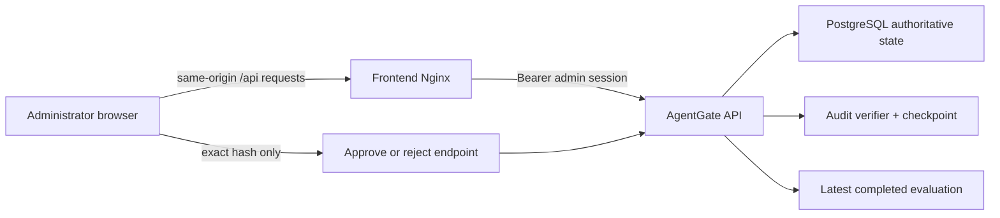

# Phase 8 explained: administrator security dashboard

Phase 8 adds a real React/TypeScript administrative console over AgentGate's
existing security controls. It does not simulate authorization in the browser.
Every displayed decision, metric, approval, identity, capability, and audit fact
comes from an authenticated backend endpoint.

## 1. Phase outcome

The dashboard implements the eight required Phase 8 views:

1. registered agents and current status;
2. tasks with assigned workloads and exact capabilities;
3. allowed, denied, failed, and approval-pending tool requests;
4. pending approvals with approve/reject actions;
5. stable policy reason codes and policy version;
6. measured evaluation results and security metrics;
7. a redacted audit-event timeline; and
8. the latest full audit-chain verification result.

The UI is intentionally an administrative client, not a second policy engine.
It cannot turn a denial into an allow, modify arguments during approval, or call
a tool adapter directly.

## 2. Runtime data flow



During local development Vite proxies `/api` to `127.0.0.1:8000`. Under Docker
Compose, Nginx proxies the same path to the API on the internal network. The
browser therefore has one origin and does not need a broad CORS exception.

## 3. Administrator session handling

The sign-in form exchanges the configured local bootstrap secret with
`POST /admin/session`. The response is a short-lived administrator token with a
separate audience from workload tokens.

The frontend applies these restrictions:

- the bootstrap secret is cleared from component state after every attempt;
- the token remains only in React memory, not `localStorage`, `sessionStorage`,
  cookies, the DOM, URLs, or console output;
- refresh or tab closure deliberately ends the session;
- a `401` from any dashboard request signs the administrator out;
- `credentials: "omit"`, `cache: "no-store"`, and `redirect: "error"` are used
  for API requests; and
- an absolute `VITE_API_BASE_URL` is accepted only for HTTP(S) loopback hosts.
  A remote host, embedded username/password, or scheme-relative URL is rejected
  before a bearer token can be sent.

This local bootstrap mechanism remains an educational control, not enterprise
SSO or a hardened privileged-access system.

## 4. Administrative read contracts

Two sanitized collection endpoints were added because Phase 8 cannot safely or
reliably reconstruct them from unrelated events:

- `GET /tasks` returns task summaries, status, assignment, trusted-instruction
  hash, and exact grants. It does not return the encrypted/full instruction.
- `GET /tool-requests?limit=100` returns newest-first request metadata, policy
  outcome/version/reason codes, approval ID, provenance metadata, sizes, and
  latency. It always sets the full `result` field to `null`.

Both endpoints require a current administrator token. Single-resource agent
access remains on the existing proof-bound endpoints and is not widened by the
dashboard.

The console also consumes:

- `GET /agents`;
- `GET /approvals`;
- `POST /approvals/{id}/approve`;
- `POST /approvals/{id}/reject`;
- `GET /audit/events?limit=100`;
- `POST /audit/verify`; and
- `GET /metrics/security`.

## 5. Exact-request approval UX

An approval card shows only server-redacted argument metadata, the requesting
agent/task/tool, expiry, reason codes, and the complete canonical SHA-256 hash.
The review dialog repeats the exact hash and requires an explicit confirmation
before approval.

The approve request sends:

```json
{
  "argument_hash": "sha256:<the exact server-provided hash>",
  "reason": "optional administrator note"
}
```

The browser never sends replacement arguments. The backend still owns the
security decision: it locks the row, verifies expiry and exact binding, decrypts
the original stored arguments, reloads live authorization context, re-evaluates
OPA, consumes once, and only then dispatches. The UI confirmation is a usability
guard, not the replay or substitution control.

## 6. Measured evidence and missing data

The evaluation panel displays the latest completed persisted run with:

- run ID and completion time;
- scenario denominator and passed count;
- legitimate/adversarial counts;
- unauthorized-action block rate;
- legitimate-task completion rate;
- attack-success rate;
- approval-enforcement accuracy; and
- mean/p95 policy latency.

The scenario-set hash is abbreviated for orientation while the complete value
remains available from the API/report. If the API returns
`NO_EVALUATION_DATA`, the panel says **Evaluation not measured**. Missing
measurements are never converted into zero or a successful posture.

The panel also labels the current measurement as an offline deterministic
policy-contract evaluation. It does not call it a live OPA, LLM red-team, or
production-effectiveness result.

## 7. Sensitive-data boundary

The interface does not render or request:

- administrator or workload bearer tokens;
- workload private/public JWK material;
- bootstrap, signing, encryption, or audit keys;
- complete trusted task instructions;
- decrypted tool arguments;
- complete email bodies or sensitive tool results; or
- report filesystem paths.

The audit view intentionally displays sequence, event type, actor type, time,
and linked request ID rather than arbitrary payload expansion. Although audit
payloads are recursively redacted on the server, keeping them collapsed reduces
the browser's operational-data exposure further.

## 8. Refresh and failure behavior

The console performs one authoritative load after authentication and refreshes
every 30 seconds. Administrators can also refresh manually. Approval completion
triggers a fresh load instead of mutating several local copies of server state.

Dashboard loading uses the server's bounded collection limits: the newest 100
tool requests and 100 audit events. A failed request produces a safe error banner;
the client does not print raw response bodies or internal exceptions. An expired
admin token returns the user to sign-in.

## 9. Browser and container hardening

The production frontend is a two-stage image:

- a pinned Node image installs the locked dependency graph and creates the Vite
  production bundle; and
- a pinned Nginx image serves only that static bundle as UID/GID `101:101`.

The container has a read-only root filesystem, a bounded temporary filesystem,
`no-new-privileges`, memory/CPU/PID limits, a loopback-only host port, and a
health check. Nginx sets:

- a same-origin Content Security Policy with objects and framing disabled;
- `X-Content-Type-Options: nosniff`;
- frame denial;
- no-referrer policy;
- a restrictive browser permissions policy; and
- same-origin opener/resource policies.

Its access log format contains method, path, status, and byte count—never request
headers or bodies. The API token is forwarded to the internal API but is not
written to the frontend access log.

## 10. Implementation map

- `frontend/src/App.tsx` — session, views, filters, approval review, and refresh.
- `frontend/src/api.ts` — constrained authenticated API client and safe errors.
- `frontend/src/types.ts` — dashboard-facing sanitized API contracts.
- `frontend/src/styles.css` — responsive, reduced-motion-aware security console.
- `frontend/tests/` — client-boundary and administrator workflow tests.
- `frontend/nginx.conf` — same-origin proxy and browser security headers.
- `frontend/Dockerfile` — pinned build and unprivileged static runtime.
- `backend/app/api/identity.py` — administrative task collection.
- `backend/app/api/tools.py` — administrative request timeline.

## 11. Verification scope

Phase 8's focused checks cover:

- TypeScript compilation and Vite production bundling;
- zero-warning ESLint;
- in-memory authentication and token non-rendering;
- rejection of remote API-base configurations;
- exact-hash approval payloads with no replacement arguments;
- real dashboard rendering from mocked HTTP contracts;
- sanitized administrative collection endpoints; and
- static Compose/Nginx/container security assertions.

The final local run produced these results:

- backend: 210 passed, 2 live-service skips, and 85.27% branch-aware coverage;
- frontend: 5 tests passed across the API-client and administrator workflow suites;
- TypeScript/Vite: production build succeeded (approximately 216 kB JavaScript
  and 23 kB CSS before gzip);
- ESLint: passed with zero warnings;
- production frontend dependency audit: no known vulnerabilities reported; and
- Ruff, strict MyPy, Bandit, `pip check`, and Python byte-compilation: passed.

The two backend skips require a disposable PostgreSQL service and live OPA URL.
They are environment limitations, not silently converted successes.

The full Phase 9 hardening pass will repeat all backend, frontend, migration,
policy, dependency, container, and evaluation gates together.

## 12. Limitations and Phase 9 handoff

- The browser client checks content type and safe error shape but does not yet use
  generated runtime schemas for every successful API response. A compromised API
  can therefore provide malformed dashboard data; it still cannot delegate its
  authorization authority to the UI.
- Collections use a fixed newest-100 window rather than cursor pagination.
- The token is protected from persistent browser storage, not from a compromised
  browser process, extension, host, or same-origin script supply chain.
- There is no enterprise identity provider, CSRF cookie flow, WebAuthn step-up,
  or multi-administrator separation of duties.
- No Docker runtime was available during this implementation, so Compose syntax
  and container contracts are tested statically; Phase 9 must run the actual
  build and startup health checks on a Docker-capable host.
- The dashboard shows already measured results. It does not execute evaluations
  or imply broader security effectiveness than the report establishes.

Phase 9 adds the CI matrix, dependency audits for both ecosystems, live
Docker/OPA/PostgreSQL verification gates, proof-bound demonstration client,
complete project documentation, and a clearly labelled synthetic portfolio
screenshot. Runtime response validation remains a documented frontend limitation;
authorization continues to be enforced exclusively by the backend. See the
[Phase 9 walkthrough](phase-9-explained.md).
