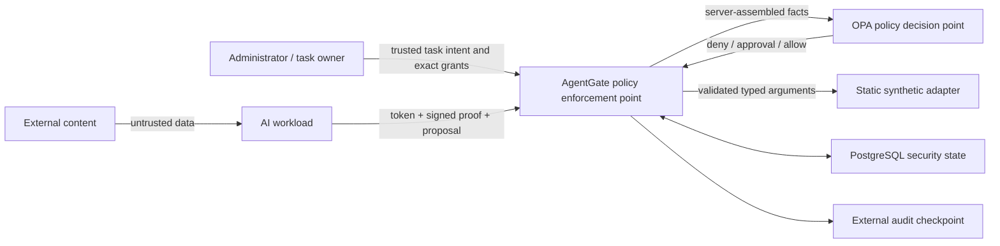

# AgentGate security model

This document is the short-form security contract for the Phase 9 MVP. The
[architecture](architecture.md) contains component detail, and the
[threat model](threat-model.md) contains STRIDE analysis and abuse cases.

## Security objective

AgentGate limits what a compromised, confused, or prompt-injected AI workload can
do. It does not ask the language model to enforce its own authority. An agent may
propose a structured tool request, but an external policy-enforcement point owns
identity validation, least privilege, provenance, approval, dispatch, and audit.

## Principals and authority

| Principal | May do | May not do |
| --- | --- | --- |
| Task owner / administrator | Register public workload keys, assign exact task capabilities, approve or reject an exact pending request, inspect sanitized evidence. | Replace arguments during approval, bypass OPA, call an adapter through the admin API. |
| Agent workload | Prove possession of its private key, obtain a task-bound token, propose typed requests, reference same-task provenance. | Self-register, self-grant, assign risk, label content trusted, select adapter code, or approve itself. |
| AgentGate PEP | Authenticate, assemble authoritative context, enforce OPA, invoke a static adapter, record evidence. | Treat model assertions as authoritative or convert an indeterminate decision into allow. |
| OPA PDP | Return `deny`, `require_approval`, or `allow` from structured input. | Authenticate callers, execute tools, or mutate application state. |

Administrator tokens and workload tokens have different audiences and code paths.
Workload access additionally requires a fresh Ed25519 proof bound to HTTP method,
path, canonical body hash, token hash, subject, expiry, and one-time identifier.

## Trust boundaries

The model, external content, browser, and adapter output are not authorization
authorities. PostgreSQL is authoritative for grants and lifecycle state, while
version-controlled code is authoritative for executable adapters and schemas.

## Enforcement order

1. Bound request parsing and reject malformed or unknown fields.
2. Validate token issuer, audience, expiry, task, and persisted credential state.
3. Verify the fresh request proof and consume its replay marker.
4. Load live agent, task, exact capability, registry, rate, and provenance facts.
5. Strictly validate the tool-specific argument schema.
6. Persist encrypted arguments and a redacted operational view.
7. Ask OPA using only server-assembled context.
8. Deny, create an exact pending approval, or dispatch the internal adapter.
9. Validate/bound the adapter result and append integrity-linked audit evidence.

At approval time, AgentGate locks the record, checks expiry and the displayed
canonical argument hash, decrypts the original server-stored arguments, reloads
all live state, re-evaluates OPA, consumes once, and only then dispatches.

## Security properties

- Default deny for unknown tools, missing capabilities/context, invalid schemas,
  policy outages, and unrecognized decisions.
- No agent-reachable adapter, database, OPA, filesystem, or shell endpoint.
- Static allowlist of seven synthetic tools with strict non-coercing schemas.
- Task-scoped exact capabilities; no wildcards.
- Server-assigned provenance labels and conservative propagation of untrusted
  influence.
- High-risk actions require trusted owner intent and an exact one-shot approval.
- Bounded request/result sizes, adapter timeouts, and server-owned rate windows.
- AES-256-GCM protection for recoverable instructions/arguments at rest.
- Redacted HMAC-linked audit records plus a separately MACed head checkpoint.
- Sanitized admin views and in-memory-only browser admin tokens.

## Failure semantics

Authentication, validation, policy, database, adapter, and integrity failures use
stable external reason codes. Raw exceptions and sensitive bodies are not
reflected. Dependency readiness fails when PostgreSQL or OPA is unavailable. A
`require_approval` result is a non-execution state, never implicit permission.

## Residual risk and non-goals

This is a single-host educational design with synthetic adapters. It does not
provide enterprise SSO, hardware-backed keys, hostile-tenant sandboxing,
multi-region consistency, WORM audit retention, external transparency anchoring,
formal policy verification, or production incident response. A compromised host,
administrator, browser process, build chain, database superuser plus checkpoint
writer, or application process can exceed the MVP's protection boundary.

The deterministic evaluation covers a declared 50-case catalog. It is regression
evidence, not a proof of prompt-injection immunity or production effectiveness.
